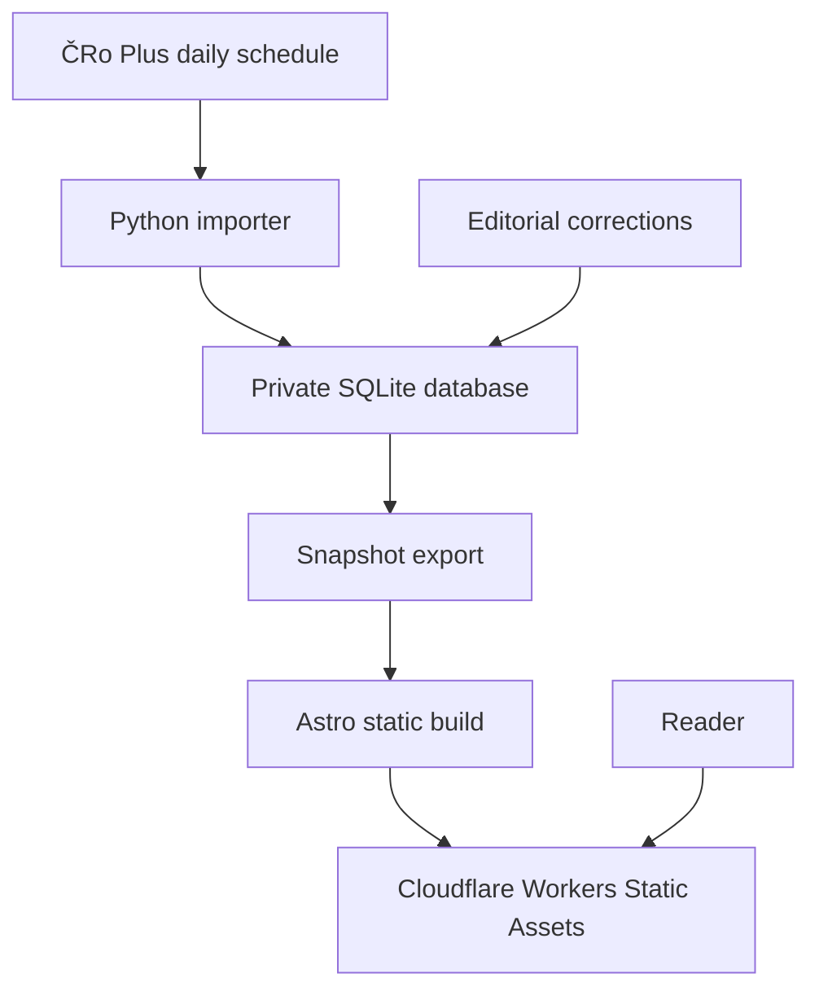

# SlantIndex architecture

The public site is precomputed. Python runs on the import host, SQLite holds the private working data, and Astro converts a consistent export into static HTML and JSON. Cloudflare Workers Static Assets serves the resulting directory. A reader can open the site while the import host is offline.

## Implemented path

| Boundary | Contract |
| --- | --- |
| Source → importer | One dated JSON response per station day. This version reads the Plus station code, transmission ID, UTC-offset start and end times, show ID, genre code and repeat flag. It discards descriptions, titles, person records and media. |
| Importer → SQLite | Validate the whole day before replacing it in one transaction. Store the URL, retrieval time and hash of the normalized projection. Rows are keyed by station, day and source transmission ID. An identical projection is a no-op. |
| Editor → SQLite | A repeat correction references a station and transmission ID, with a reason and source. The reviewed view applies the override. Refreshing or temporarily losing a slot preserves the decision. |
| SQLite → Astro | One read transaction produces a date-ordered JSON export, including absent days. A slot counts on its local start date. A carryover returned in the next day’s schedule still contributes coverage there. Coverage uses UTC elapsed seconds clipped to each Prague day, merging overlapping intervals. |
| Astro → Cloudflare | Both HTML and the downloadable JSON come from that export at build time. Deploy only `site/dist/`. The public read path has no database binding, server-side rendering or dependency on a live ČRo API. |

## Operation

Bootstrap with the last 30 completed Prague days. Refresh the last seven days on subsequent runs, then export the entire display window. Each successful day commits independently. A failed refresh exits nonzero and retains the previous successful version of that day. Chain import, export, build and deploy on success so readers keep the last published build during a failure. Historical reruns accept explicit inclusive dates. The SQLite database belongs on persistent storage. A periodic runner and backups are deployment work for the import host.

## Subsequent releases

- Match transmissions to stable mujRozhlas episode IDs and retain evidence for each on-air credit. A repeat may point to a previous episode. Check uncertain matches before counting appearances. Complete the privacy and retention decisions in the design before storing identifiable material.
- Extend the same build-time export with credited segments, approved assessments and coverage thresholds. Store provenance and revisions in the private database. Rebuild an affected period after an accepted correction.
- The public correction form introduces a small request-time write path. A Worker accepts submissions into a private D1 queue. An editor applies a decision locally and triggers the next static build. Public page reads continue to use static assets.

[Product scope](DESIGN.md) · [Source and matching rules](SOURCES.md) · [Scoring rules](METHODOLOGY.md) · [Archive pilot](docs/archive-pilot.md)
